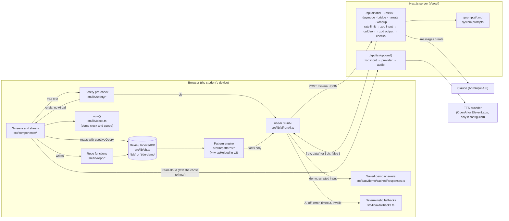
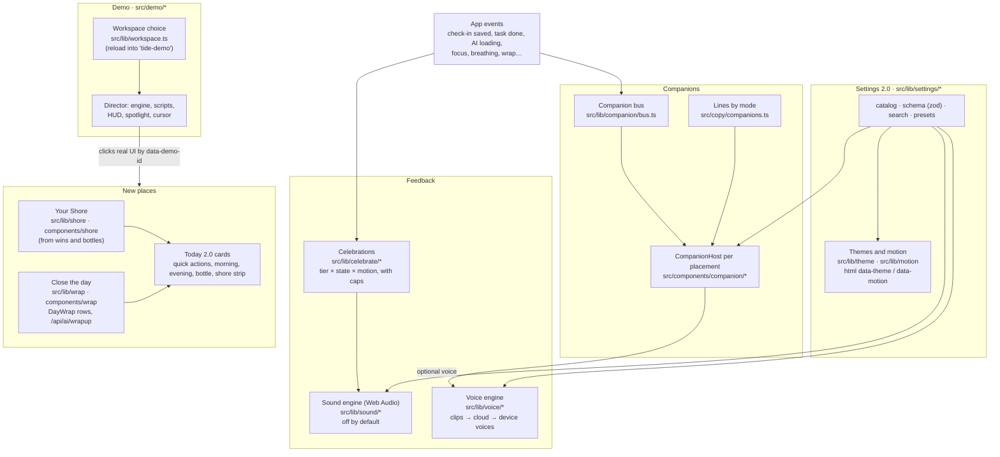

# Architecture

Tide is a local-first web app. Everything a student records lives in their
own browser (IndexedDB, through Dexie). The only server code is a handful
of small route handlers: six relay minimal text to Claude and return
validated JSON, and one (optional) turns text someone asked to hear into
speech. They store nothing and log only the route, status, latency and
whether the browser will fall back. The pattern engine runs in the browser
as plain code; the AI only puts its results into words.

v2 added the parts in the second diagram: themes and motion, sound, the
voice engine, companions that react to events, celebrations, Your Shore,
Close the day (with a new AI route), Settings 2.0, and a demo that runs in
its own database. None of them changed how v1's data, safety layer or AI
routes work.

## Data, safety and AI (v1, extended in v2)

## The v2 experience layer

## The pieces

- **Screens and sheets** (`src/components/*`): one folder per module. They
  read data live with `useLiveQuery` and never write to the database directly.
- **Repo functions** (`src/lib/repo/*`): every write, with its side effects
  (finishing a task adds a win; a crisis check-in is saved without text;
  closing the day adds driftwood and applies the loose-end choices).
- **Database** (`src/lib/db.ts`): Dexie version 2 adds `dayWraps` and
  `bottles` and win kinds; the upgrade from v1 keeps every row. Its name is
  `tide`, or `tide-demo` inside the demo workspace.
- **Clock** (`src/lib/clock.ts`): the only code that reads the system time.
  In the demo it returns the demo's time (and can run faster).
- **Safety** (`src/lib/safety/*`): a whole-phrase keyword check in English
  and Spanish that runs before any free text could reach the AI. The crisis
  screen never shows a companion, a celebration or a playful element.
- **AI client side** (`src/lib/ai/runAi.ts`, `useAi.ts`): AI off → fallback;
  demo with a scripted input → saved answer; otherwise call the route with a
  timeout and validate the answer again in the browser.
- **AI server side** (`src/app/api/ai/*`, `src/lib/ai/route.ts`,
  `client.ts`): rate limit, zod on the input, one Claude call with the
  route's system prompt, zod and semantic checks on the output, one retry,
  then an `{ ok: false }` envelope that makes the browser fall back. The
  wrap-up route only receives counts, titles and chosen words.
- **Voice** (`src/lib/voice/*`, `/api/tts`): picks the most natural voice
  available (saved clips, then the cloud voice if the team set one up, then
  the device's best voice), rewrites text for speech and reads it in short
  pieces. Dictation (`src/lib/speech.ts`) is v1's, unchanged.
- **Sound** (`src/lib/sound/*`): every sound is synthesized with Web Audio
  after a first gesture; nothing plays until someone turns sound on.
- **Companions** (`src/lib/companion/*`, `src/components/companion/*`):
  screens emit events on a small bus; each `CompanionHost` reacts with an
  expression and maybe a line, following talkativeness and placements.
  Only one companion loops at a time, and loops pause off screen.
- **Celebrations** (`src/lib/celebrate/*`): the size of a celebration
  depends on the win and on how Maya feels (a quiet toast on a low day),
  on the motion level, and on caps (one big overlay per 10 minutes, three
  small ones a minute).
- **Pattern engine** (`src/lib/patterns/*`): deterministic rules over the
  last 7 or 28 days, at least 3 observations (or 5 by choice), "k of n" and
  confidence. Only the computed facts go to the narrate route.
- **Demo** (`src/demo/*`, `src/lib/workspace.ts`): the launcher reloads into
  the demo database, seeds it, and the director plays a script against the
  real screens. Leaving reloads into the main database.

## Why it's built this way

- **Local-first** keeps sensitive records on the student's device and makes
  the app work without a network (the AI degrades to built-in suggestions).
- **The code calculates, the AI words** keeps statistics honest and
  testable; the AI can't invent a number on a pattern card or a summary.
- **Validation on both sides** means a bad or stale answer never reaches the
  student.
- **One clock** makes the stage demo reproducible on any laptop.
- **A separate demo database, chosen at load** means no code path can touch
  the student's data while the tour runs.
- **Events, not calls, for the companion** keep it optional: with no
  companion, or on the crisis screen, nothing listens and nothing changes.
