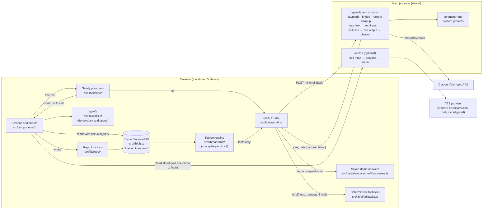
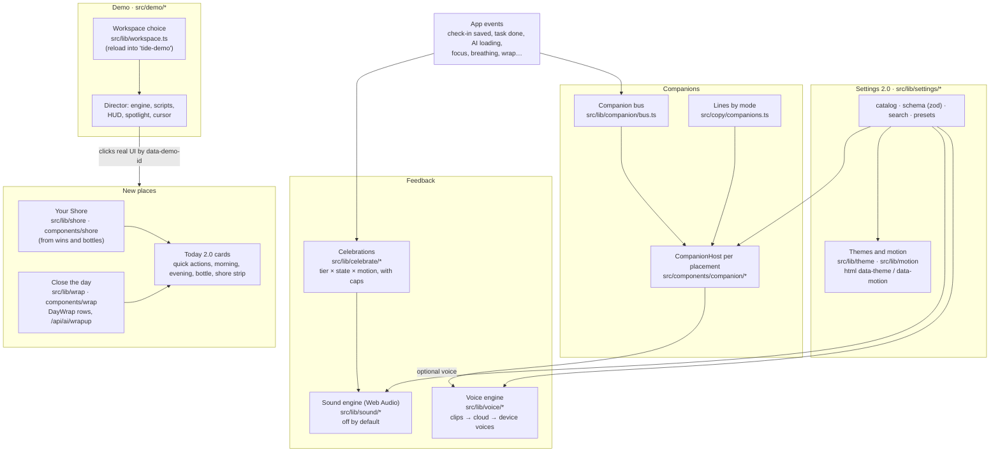

# Architecture

We built Tide as a local-first web app. Everything a student records lives
in their own browser (IndexedDB, through Dexie). The only server code is a
handful of small route handlers: six relay minimal text to Claude and
return validated JSON, and one (optional) turns text someone asked to hear
into speech. They store nothing and log only the route, status, latency and
whether the browser will fall back. The pattern engine runs in the browser
as plain code; the AI only puts its results into words. For a
module-by-module tour, see [CODE_GUIDE.md](CODE_GUIDE.md).

v2 added the parts in the second diagram: themes and motion, sound, the
voice engine, companions that react to events, celebrations, Your Shore,
Close the day (with a new AI route), Settings 2.0, and a demo that runs in
its own database. None of them changed how v1's data, safety layer or AI
routes work.

## Folder map

```
src/app/            routes: Today, Tasks, Toolkit, Patterns, Shore, Proof,
                    Settings, Support, Focus, Close the day, Companion,
                    Onboarding, Demo, /prompts-doc, /api/ai/*, /api/tts,
                    and development-only pages under /dev
src/components/     one folder per module (checkin, tasks, focus, today,
                    calendar, events, bridge, toolkit, patterns, proof,
                    safety, settings, shell, companion, celebrate, shore,
                    wrap, onboarding, looks, ambience, ui)
src/lib/            the database and repo functions, the clock, the AI
                    layer, safety, the pattern engine, Day Mode and Bridge
                    rules, themes, motion, sound, voice, companions,
                    celebrations, the Shore, Close the day, settings,
                    overlays and the workspace switch
src/demo/           the guided tour: launcher, director, scripts, tour bar
src/data/           emotion words, strategies, task types, crisis lines,
                    looks, the demo seed and its saved answers
src/copy/           every word on screen, split so Today loads only its own
prompts/            the six system prompts and the shared preamble
scripts/            layout audit, visual comparison, tour check, budget
```

## Data model

| Table | Key | What it holds |
|---|---|---|
| `checkins` | id | Words, chosen feelings, energy and pleasantness, the quadrant, the need |
| `tasks` | id | Title, type, energy cost, status (including Stuck), due date, deleted and cleared marks |
| `events`, `eventSeries` | id | Calendar events and weekly series |
| `focusBlocks` | id | Focus sessions and their outcome |
| `strategyUses` | id | Each strategy run and "better, same or worse" |
| `transitions` | id | Bridges between events and how they went |
| `wins` | id | Things done, for the Proof log and the Shore |
| `rewards` | id | Small rewards the person sets for themselves |
| `dayPlans`, `dayWraps`, `bottles` | date, date, id | Day Mode plans, closed days, notes in a bottle |
| `dismissedPatterns` | key | Patterns marked "Not true for me" |
| `settings` | key | Every preference, as key and value |

The schema is at Dexie version 3; each version only adds, with an upgrade
that keeps every existing row.

## Data, safety and AI (v1, extended in v2)



## The v2 experience layer



## The pieces

- **Screens and sheets** (`src/components/*`): one folder per module. They
  read data live with `useLiveQuery` and never write to the database directly.
- **Repo functions** (`src/lib/repo/*`): every write, with its side effects
  (finishing a task adds a win; a crisis check-in is saved without text;
  closing the day adds driftwood and applies the loose-end choices).
- **Database** (`src/lib/db.ts`): version 2 added `dayWraps`, `bottles`
  and win kinds, version 3 deleted and cleared tasks and weekly event
  series; each upgrade keeps every row. Its name is `tide`, or `tide-demo`
  inside the demo workspace.
- **Clock** (`src/lib/clock.ts`): the only code that reads the system time.
  In the demo it returns the demo's time (and can run faster).
- **Safety** (`src/lib/safety/*`): a whole-phrase keyword check in English
  and Spanish that runs before any free text could reach the AI. The crisis
  screen never shows a companion, a celebration or a playful element.
- **AI client side** (`src/lib/ai/runAi.ts`, `useAi.ts`): AI off → fallback;
  demo with a scripted input → saved answer; otherwise call the route with a
  timeout and validate the answer again in the browser.
- **AI server side** (`src/app/api/ai/*`, `src/lib/ai/route.ts`,
  `client.ts`): rate limit, zod on the input, one Claude call with the
  route's system prompt, zod and semantic checks on the output, one retry,
  then an `{ ok: false }` envelope that makes the browser fall back. The
  wrap-up route only receives counts, titles and chosen words.
- **Voice** (`src/lib/voice/*`, `/api/tts`): picks the most natural voice
  available (saved clips, then the cloud voice if we set one up, then the
  device's best voice), rewrites text for speech and reads it in short
  pieces. Dictation (`src/lib/speech.ts`) is v1's, unchanged, and a test
  keeps it that way.
- **Sound** (`src/lib/sound/*`): every sound is synthesized with Web Audio
  after a first gesture; nothing plays until someone turns sound on.
- **Companions** (`src/lib/companion/*`, `src/components/companion/*`):
  screens emit events on a small bus; each `CompanionHost` reacts with an
  expression and maybe a line, following talkativeness and placements.
  Only one companion loops at a time, and loops pause off screen.
- **Celebrations** (`src/lib/celebrate/*`): the size of a celebration
  depends on the win and on how Maya feels (a quiet toast on a low day),
  on the motion level, and on caps (one big overlay per 10 minutes, three
  small ones a minute).
- **Pattern engine** (`src/lib/patterns/*`): deterministic rules over the
  last 7 or 28 days, at least 3 observations (or 5 by choice), "k of n" and
  confidence. Only the computed facts go to the narrate route.
- **The phone frame and overlays** (`src/components/shell/PhoneFrame.tsx`,
  `src/lib/overlay/*`): every screen, sheet and companion bubble lives in
  one phone-sized frame, even on a laptop, and every layer has one token on
  a z-index scale. A bubble that would cover a timer, a field or a main
  button moves to a caption bar instead.
- **Demo** (`src/demo/*`, `src/lib/workspace.ts`, `src/lib/repo/demo.ts`):
  the launcher reloads into the demo database, which is seeded in one
  atomic transaction (and only ever the demo database), and the director
  plays a script against the real screens. The director is a small state
  machine (idle, starting, running, paused, finished): each step can be
  called off and resumed, pause freezes the demo clock, a narrator reads
  each caption through the voice engine, and every caption gets its
  reading time once the screen has settled. Leaving reloads into the main
  database.

## Why it's built this way

- **Local-first** keeps sensitive records on the student's device and makes
  the app work without a network (the AI degrades to built-in suggestions).
- **The code calculates, the AI words** keeps statistics honest and
  testable; the AI can't invent a number on a pattern card or a summary.
- **Validation on both sides** means a bad or stale answer never reaches the
  student.
- **One clock** makes the stage demo reproducible on any laptop.
- **A separate demo database, chosen at load** means no code path can touch
  the student's data while the tour runs.
- **Events, not calls, for the companion** keep it optional: with no
  companion, or on the crisis screen, nothing listens and nothing changes.
