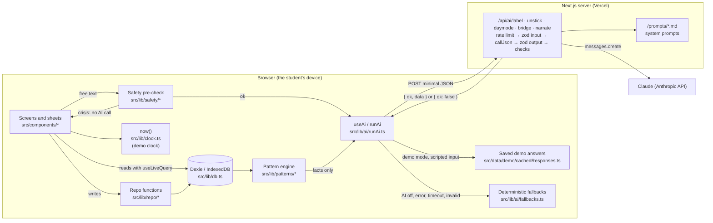

# Architecture

Tide is a local-first web app. Everything a student records lives in their
own browser (IndexedDB, through Dexie). The only server code is five small
route handlers that relay minimal text to Claude and return validated JSON;
they store nothing and log only the route, status, latency and whether the
browser will fall back. The pattern engine runs in the browser as plain code;
the AI only puts its results into words.

## The pieces

- **Screens and sheets** (`src/components/*`): one folder per module. They
  read data live with `useLiveQuery` and never write to the database directly.
- **Repo functions** (`src/lib/repo/*`): every write, with its side effects
  (finishing a task adds a win; a crisis check-in is saved without text).
- **Clock** (`src/lib/clock.ts`): the only code that reads the system time.
  In demo mode it returns Thursday, November 5 plus the time since the demo
  started.
- **Safety** (`src/lib/safety/*`): a whole-phrase keyword check in English
  and Spanish that runs before any free text could reach the AI.
- **AI client side** (`src/lib/ai/runAi.ts`, `useAi.ts`): AI off → fallback;
  demo mode with a scripted input → race the live call against the saved
  answer; otherwise call the route with a timeout and validate the answer
  again in the browser.
- **AI server side** (`src/app/api/ai/*`, `src/lib/ai/route.ts`,
  `client.ts`): rate limit, zod on the input, one Claude call with the
  route's system prompt, zod and semantic checks on the output, one retry,
  then an `{ ok: false }` envelope that makes the browser fall back.
- **Pattern engine** (`src/lib/patterns/*`): four deterministic rules over
  the last 7 or 28 days, at least 3 observations, "k of n" and confidence.
  Only the computed facts go to the narrate route.

## Why it's built this way

- **Local-first** keeps sensitive records on the student's device and makes
  the app work without a network (the AI degrades to built-in suggestions).
- **The code calculates, the AI words** keeps statistics honest and
  testable; the AI can't invent a number on a pattern card.
- **Validation on both sides** means a bad or stale answer never reaches the
  student.
- **One clock** makes the stage demo reproducible on any laptop.
